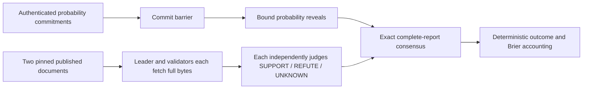
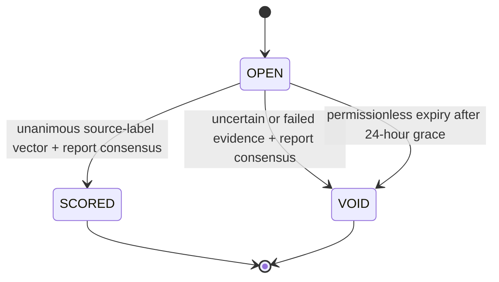

# SealedBeliefScoreboard

Commit/reveal probability accounting with independently evidence-resolved, integer Brier scores. An experimental GenLayer primitive, not a financial market, certificate issuer, or factual-truth oracle.

Live StudioNet contract: [`0xdD085aa0d0074D4f2c4cf0b8071A9D0860be8a79`](https://explorer-studio.genlayer.com/address/0xdD085aa0d0074D4f2c4cf0b8071A9D0860be8a79). [Proof matrix](LIVE_PROOFS.md): 14 finalized transactions, 12 successful executions and 2 expected rejections. [Portal submission](SUBMISSION.md).

## Problem and consensus boundary

A forecast recorder can seal probabilities but cannot interpret an ambiguous published outcome document. A private AI judge could pick an outcome alone. Here authenticated participants seal their probabilities first; GenLayer independently acquires the exact documents and agrees on the consequential interpretation before accounting changes.

The caller specifies a question and source commitments, **not the outcome, source body, semantic label, score or confidence**. Forecast probabilities are participant beliefs, intentionally not accepted as factual evidence. The contract owns identity checks, deadlines, acquisition, two document-level judgments, exact comparison, answer/vector consistency and scoring. Sources own their published contents; source reliability remains an external trust assumption.



## Not another graph variant

Storage is sealed probability books, immutable final score sheets and creator-scoped cumulative statistics. There are no objects, edges, graph heads, parent versions, structural proposals, consumable certificates or privileged finalizers. Semantic document interpretation changes the outcome bit and therefore every revealed participant's numerical loss. Replacing that judgment with the opposite consensus label reverses the scoring incentive; it is not decorative AI.

## Workflow and liveness

1. `open_round`: anyone creates a bounded binary question, fixed roster of 1–8 distinct addresses, two commit-pinned GitHub documents and fixed commit/reveal deadlines. Creator nonce cannot be reused; at most 32 rounds per creator per deployment.
2. `commit_probability`: invited sender records one immutable commitment. Invitation alone never changes that participant's aggregate statistics.
3. `reveal_probability`: sender reveals integer probability in `[0,10000]` and 32-byte hexadecimal salt. Reveals start once everyone has committed **or** the commit deadline passes. No commitment can be added after the barrier.
4. `resolve`: **anyone** can trigger independent acquisition and outcome reasoning once everyone revealed or the reveal deadline passes. Neither creator nor absent participant has a veto.
5. If web/LLM consensus cannot complete, anyone may `void_expired` after reveal deadline plus 24 hours. It records an explicit no-evaluation fallback, not an outcome.



`OPEN` has computed commit/reveal phases; all final states are terminal. A GenLayer validator disagreement does **not** manufacture a `CONFLICTED` business result: no successful resolution means no score mutation; normal consensus retries/appeal are network mechanisms. Permanent failure has the explicit timeout-to-VOID path.

## Evidence and consensus

Only `https://raw.githubusercontent.com/OWNER/REPO/FULL_COMMIT/PATH` URLs constructed inside the contract are accepted. Paths cannot escape, include queries or arbitrary hosts. Each fetch is bounded to 6000 full response bytes and UTF-8; no truncated input is judged. Full SHA-256, HTTP status, source URL, body, configuration root, forecast book and labels are part of the exact report independently reproduced by validators.

Both SUPPORT → YES; both REFUTE → NO. Every mixed or UNKNOWN vector → UNKNOWN/VOID. Acquisition failure forces both UNKNOWN and cannot issue a score. A deterministic post-consensus check derives the answer again and rejects contradictory answer/vector pairs. Malformed model output is an LLM error and validators refuse it, not an automatic approval.

There is no confidence tolerance. Prompt strings are untrusted data and never instructions; this mitigates, but cannot prove elimination of, model prompt injection or correlated semantic mistakes.

## Scoring and security

For probability `p` in basis points and outcome `y` in `{0,1}`:

`loss = (p - 10000*y)^2`; `score = 100000000 - loss`.

Scores are non-transferable accounting units. No tokens, escrow, payments or settlement transfers exist. Integer Brier loss is strictly proper for genuinely uncertain binary outcomes. A committed participant who withholds a reveal on a scoreable round gets score zero / maximum loss, so selective revelation cannot improve the reported score. A VOID round records void counts but no win/loss. Uncommitted invitees are NOT_COMMITTED without global penalties.

Commitment preimage is canonical sorted ASCII JSON of `policy, contract, round, participant, probability, salt`. Round ID binds contract, creator and nonce; round configuration binds sources and deadlines. Use cryptographically random salts; an unsalted 10001-value probability domain is trivially enumerable. Never publish a salt before reveal. No key is exported by deployment scripts.

`get_stats(creator, participant)` exposes committed/scored/pending/void/missed-reveal counts plus exact score/loss sums. No global ranking or predictive-skill guarantee is claimed: creators choose questions and sources, identities are not Sybil resistant, and statistics across different question sets are not directly comparable. Deadline timing uses GenLayer's transaction datetime, not caller time.

## Demo and limitations

The repository's authored archive policy and FAQ are controlled public fixtures. Both explicitly deny unapproved bulk downloads. A sealed 20% YES belief therefore gets NO outcome, loss 4,000,000 and score 96,000,000. A wrong reveal is rejected; a bad source commitment voids a second round; a withheld reveal times out to worst-score accounting on a scoreable third round. See [LIVE_PROOFS.md](LIVE_PROOFS.md) for verified execution evidence when available.

These documents were public before the commits. This proves protocol mechanics, **not forecasting skill, future-event freshness, independent authorities or real-world service delivery**. Source pinning proves which published revision was used; it does not make an old document current. This implementation is intentionally a fixed-document interpretation scoreboard. Live future-event prediction requires a separately designed later-publication/acquisition policy; it is not claimed here.

## Install and test

```powershell
python -m venv .venv
.venv\Scripts\pip install -r requirements-dev.txt
npm ci --ignore-scripts
.venv\Scripts\genvm-lint check contracts/SealedBeliefScoreboard.py
.venv\Scripts\python -m pytest tests -q
npm run test:sdk
```

43 tests include all 9 semantic vectors; authenticated two-participant scoring; wrong probability/salt/principal/round; replay; exact deadlines; missing commits/reveals; permanently unavailable resolution; bad HTTP/hash/encoding/size; malformed AI output; actual validator callback disagreement; forged post-consensus reports; all 10001 probability values and integer properness identities. Direct-mode mocks are not distributed consensus proofs. The narrow Windows cleanup fixture fixes gltest's open-temporary-file unlink only.

## Deploy and interact

```powershell
npm install -g genlayer@0.39.2
genlayer network set studionet
genlayer account create --name belief-test
genlayer account use belief-test
genlayer account unlock
genlayer deploy --contract contracts/SealedBeliefScoreboard.py
genlayer schema CONTRACT_ADDRESS
```

StudioNet is the gasless test environment. Account creation/unlock use native encrypted keystore/OS vault; never paste keys or passwords into Git/chat. The first contract line pins the GenVM runner. After deployment, inspect execution SUCCESS **and** lifecycle FINALIZED; an accepted/finalized execution error does not create a contract.

For the dedicated demonstration signer, `scripts/demo.mjs STEP ADDRESS FIXTURE_COMMIT` sends exactly one documented step. Set `BELIEF_TEST_ACCOUNT` and `BELIEF_CLI_PATH` to an unlocked dedicated native CLI account and CLI entrypoint. Steps: `open-good`, `commit-good`, `wrong-reveal` (expected error), `reveal-good`, `resolve-good`, `replay-good` (expected error); `open-void`, `commit-void`, `reveal-void`, `resolve-void`; `open-missing`, `commit-missing`, then `resolve-missing` only after its two 60-second windows. Demo salts live in the OS vault, not files. Other signers should build their own canonical commitments; the demo helper is intentionally limited to the documented public signer.

A solitary hexadecimal roster address is automatically coerced to typed Address by CLI 0.39.2, but `participants` is a string API. The demo sends its public address in base64; the contract normalizes it to the same checksummed address. Multi-address rosters are `|`-delimited strings. This is calldata encoding, not an authorization exception. An earlier failed creation with typed Address calldata is excluded from the proof lifecycle.

`scripts/run-cli.cjs` selects account/network process-locally, uses only already-signed transaction bytes, deduplicates identical broadcasts and suppresses unsafe raw receipt/config output. A timeout/network error is uncertain: inspect the known hash/history before **any** resubmission. Never treat CLI exit zero as execution evidence.

Safe verification commands:

```powershell
node scripts/check.mjs success TX_HASH
node scripts/check.mjs error TX_HASH "Reveal commitment mismatch"
node scripts/check.mjs source CONTRACT_ADDRESS
node scripts/check.mjs round CONTRACT_ADDRESS ROUND_ID
node scripts/check.mjs stats CONTRACT_ADDRESS CREATOR_ADDRESS PARTICIPANT_ADDRESS
```

Explorer: `https://explorer-studio.genlayer.com/address/ADDRESS` and `/tx/HASH`. The source checker compares fetched deployed code against the repository contract after CRLF normalization and prints only SHA-256 and equality. Round checks recompute configuration/final roots, source byte hashes, answer/vector consistency and Brier scores. Expected error transactions are separate negative proofs, never successful scoring claims.
